<p align="center"></p>
<h1 align="center">Pocket Analytics</h1>
<p align="center">Who visits your websites, without cookies and without a banner. You see visitors and pages, where people came from (search, social, AI assistants, newsletters, campaigns), their country and city, and their device and browser. You also see how long people stay, how far down they read, which links and files they click, how fast your pages are, the broken links people land on, what they search for, your goals (with the money they bring) and funnels, single visits, and who is on the site right now. Add one small script to each site. The IP address is never stored, and the same person can't be followed from one day to the next. A replacement for Google Analytics, Plausible or Umami.<br>One Go binary, one SQLite file, one volume. Part of the Pocket apps; works on its own too.</p>
<p align="center">
  <a href="https://github.com/abjelosevic88/pocket-homelab-analytics/actions"></a>
  <a href="https://github.com/abjelosevic88/pocket-homelab-analytics/pkgs/container/pocket-homelab-analytics"></a>
  <a href="LICENSE"></a>
</p>

<p align="center">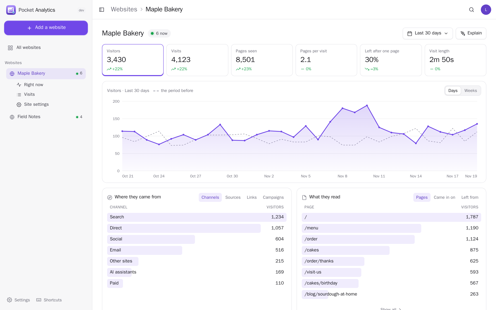</p>

<table>
  <tr>
    <td width="50%">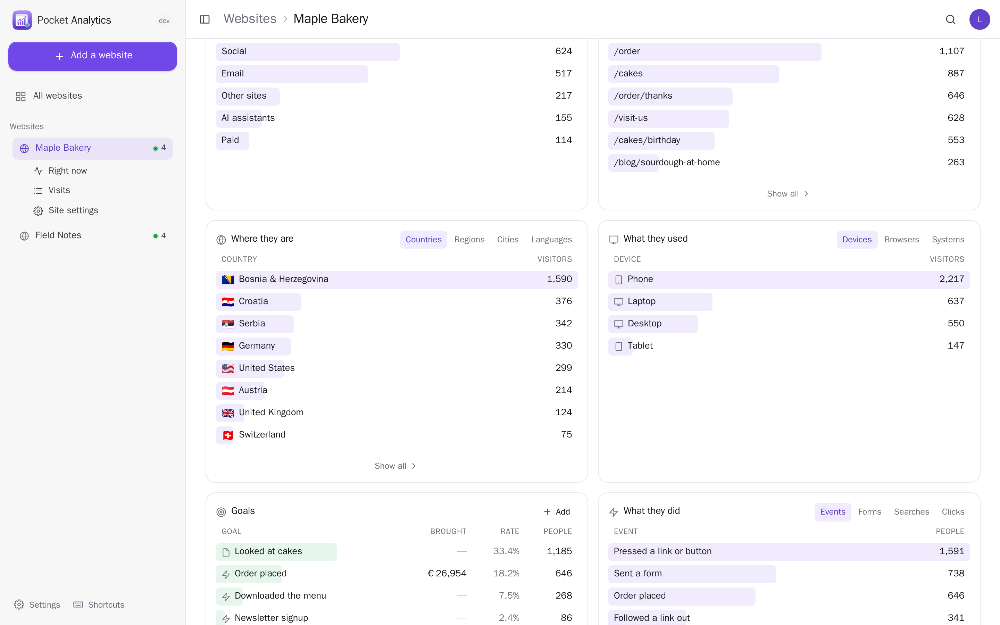</td>
    <td width="50%">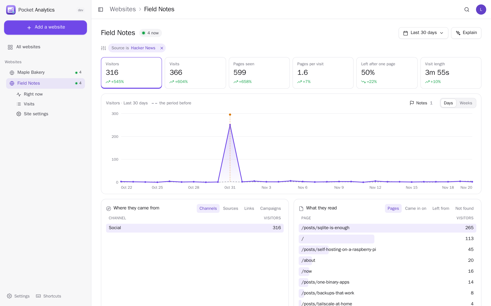</td>
  </tr>
  <tr>
    <td align="center"><sub>Where they are, what they used, goals and what they did. Every row is a filter.</sub></td>
    <td align="center"><sub>Click a source and the whole page shows only those visits.</sub></td>
  </tr>
  <tr>
    <td width="50%">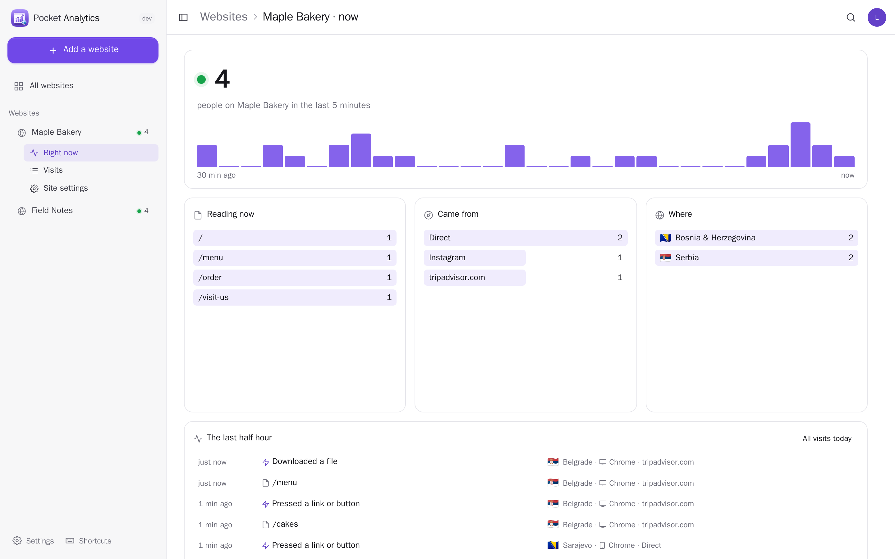</td>
    <td width="50%">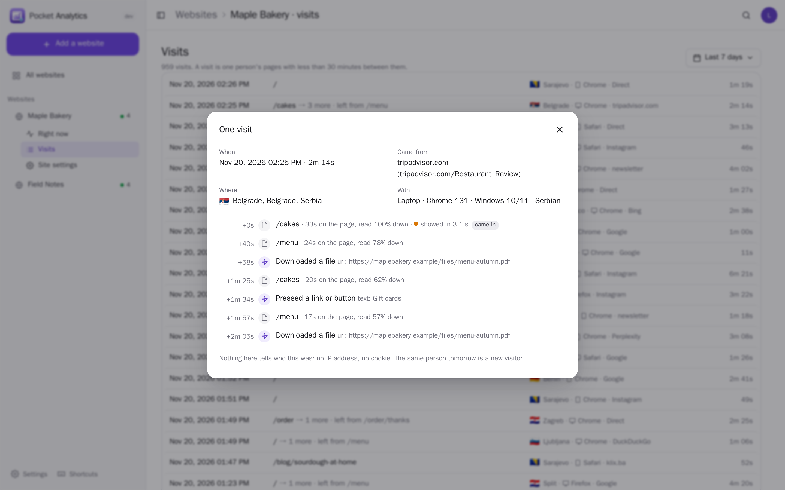</td>
  </tr>
  <tr>
    <td align="center"><sub>Right now: who is on the site, what they read, the last half hour.</sub></td>
    <td align="center"><sub>One visit: where it came from and each page in order. Never who it was.</sub></td>
  </tr>
  <tr>
    <td width="50%">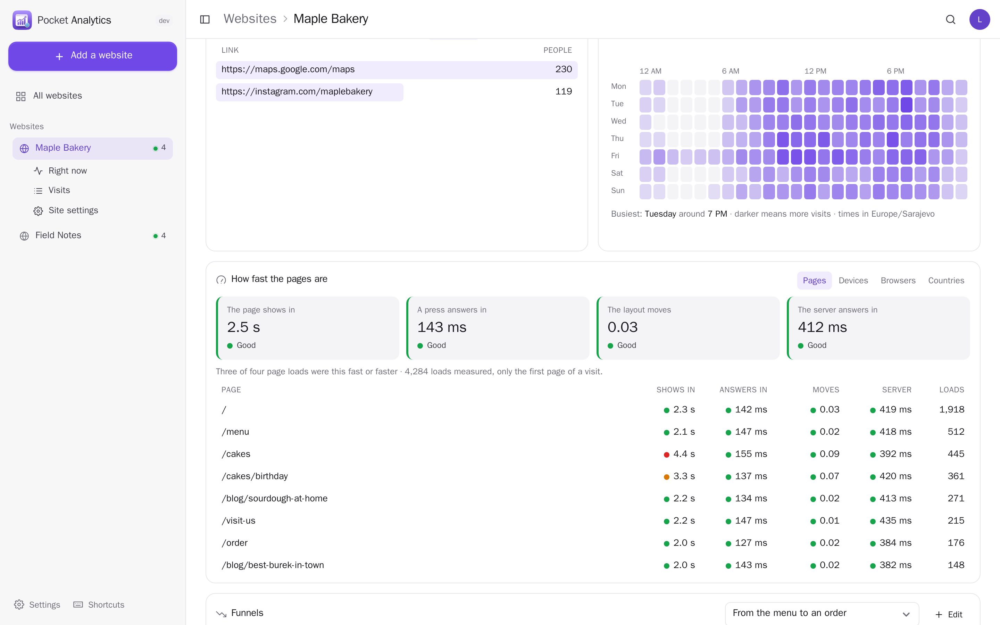</td>
    <td width="50%">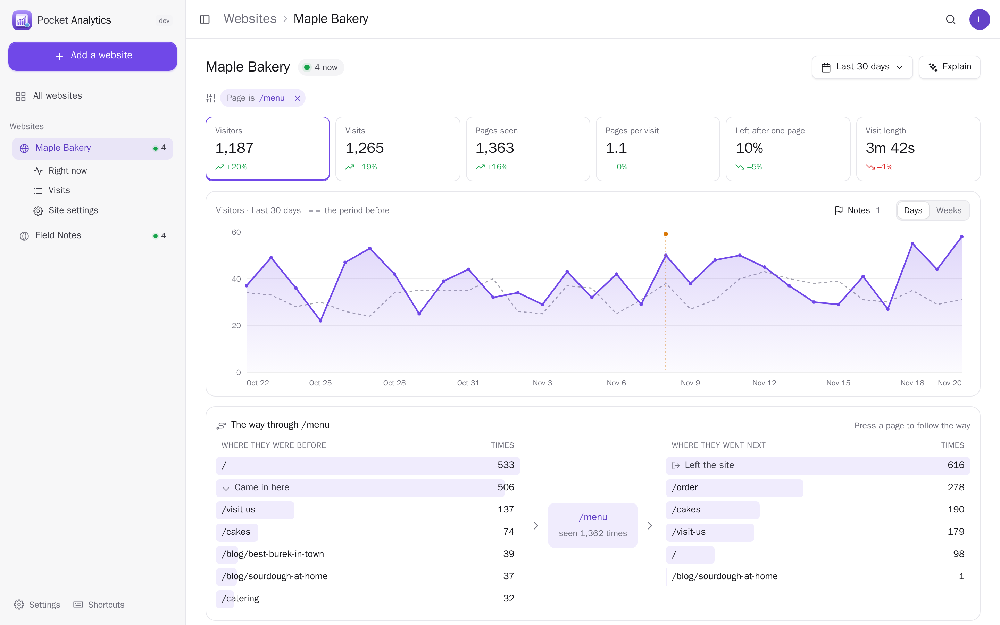</td>
  </tr>
  <tr>
    <td align="center"><sub>The busy hours of the week, and how fast each page shows and answers.</sub></td>
    <td align="center"><sub>The way through a page: where people were before, where they went next.</sub></td>
  </tr>
  <tr>
    <td width="50%">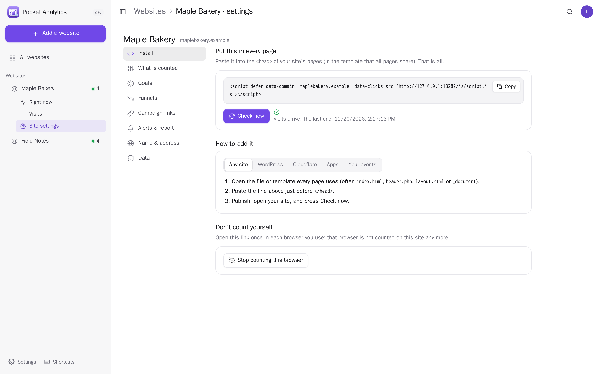</td>
    <td width="50%">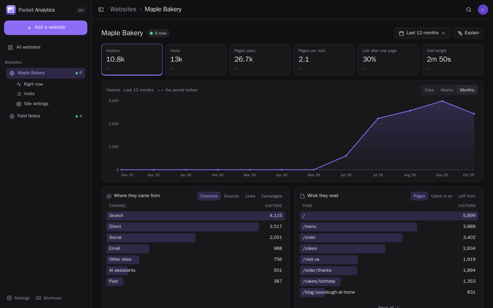</td>
  </tr>
  <tr>
    <td align="center"><sub>One line in the page's head; guides for WordPress, Cloudflare Workers and apps.</sub></td>
    <td align="center"><sub>Light and dark follow your system.</sub></td>
  </tr>
  <tr>
    <td width="50%">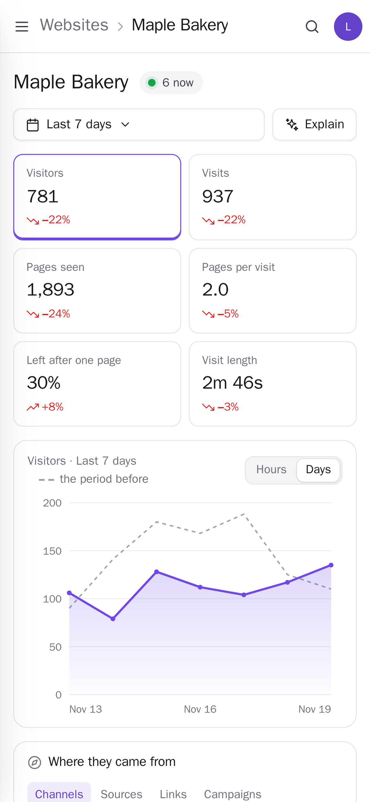</td>
    <td width="50%">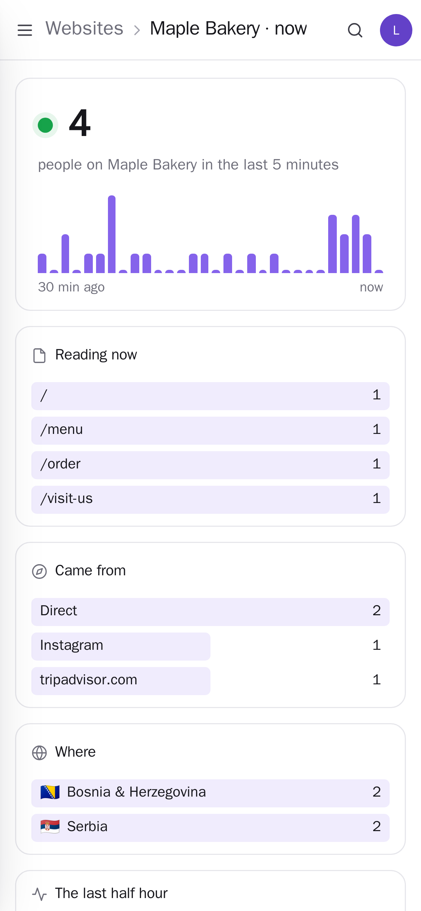</td>
  </tr>
  <tr>
    <td align="center"><sub>Your numbers on the phone.</sub></td>
    <td align="center"><sub>Who is on the site, in your pocket.</sub></td>
  </tr>
</table>

## What it does

- **The numbers**: visitors, visits, pages seen, pages per visit, people who left after one page, visit length. Each is compared with the period before, and the chart shows that period as a dashed line. Ranges go from today to all time, shown by hour, day, week or month.
- **Where they came from**: channels (search, social, AI assistants, email, paid, other sites, direct), sources, the exact pages that linked to you, and `utm_` campaigns.
- **What they searched on Google**: the words, how often you were shown, your place in the results and the clicks, from Google Search Console. Also the pages Google sent people to. One key file from your own Google account, pasted once (Settings → Google Search walks you through it).
- **What they read**: top pages with time on the page and how far down people scrolled, plus the pages people came in on and left from. Filter by a page and you see **the way through it**: where people were before and where they went next.
- **Pages that do not exist**: the addresses people land on that your site does not have, and the page with the broken link.
- **How fast the pages are**: how long a page takes to show, to answer a press, how much the layout jumps and how fast the server answers (Core Web Vitals, measured in the visitor's browser), by page, device, browser and country, in green, amber and red.
- **Where they are**: countries, regions, cities and languages. Places come from an offline DB-IP database on your box, or from Cloudflare when the site runs there.
- **What they used**: phone, tablet, laptop or desktop; browser and system.
- **What they did**: links to other sites, file downloads, email and phone links pressed, forms sent (never what was typed), searches on your site, every button (optional), and your own events with properties (`pocket('Order placed', { props: { type: 'pickup' } })` or `data-pocket-event`). Click an event to see its details.
- **Goals and funnels**: a page reached or an event sent counts as a goal, and shows the money it brought when the event says so (`revenue: { amount: 24.5, currency: 'EUR' }`). A funnel shows where people drop off between steps.
- **Robots that read the site**: which AI assistants (learning, or answering someone's question), search engines and link previews (someone shared your link) read which pages. Robots never run the script, so your site's own server reports them (the Cloudflare Worker from Install does). They are never counted as visitors.
- **When they come**: a week of hours, darker where more people visit.
- **Notes on the chart**: mark the day a newsletter went out or a design changed, so a rise or a drop explains itself later.
- **Campaign links**: a small builder for links that say where a visit came from (a newsletter, a QR code, an ad).
- **Filters everywhere**: click any row and the whole page shows only those visits. The address keeps the view, so it can be shared.
- **Visits one by one** and **right now**: the pages of each visit in order, and the people on the site this minute.
- **Pocket AI explains** a period in plain words, and you can keep that as a note or a task.
- **Messages**: a weekly report (also by email through Pocket Mail), a note when far more people come than usual, and one when a site that usually has visitors goes quiet for a day.
- **Private by design**: no cookies, and nothing stored that identifies a person. Robots are left out. A link stops counting your own browser.
- **Plausible-compatible**: the same event endpoint and fields, so Plausible's script works too; `window.plausible()` and `plausible-event-name=` classes work in Pocket's script.

## Run it

```sh
docker run -d --name pocket-analytics -p 8080:8080 -v pocket-analytics:/data \
  -e BASE_URL=https://analytics.example.com -e SECURE_COOKIES=true \
  ghcr.io/abjelosevic88/pocket-homelab-analytics:latest
```

You can also use `docker compose up -d` with [docker-compose.yml](docker-compose.yml). Open the app, create the first account, add a website and paste the line it shows into your pages. Websites must be able to reach `/js/script.js` and `/api/event`. To keep the app itself private, give those two a public hostname with `PUBLIC_URL` ([docs/configuration.md](docs/configuration.md), [docs/reverse-proxy.md](docs/reverse-proxy.md)). Binaries for Linux, macOS, Windows and FreeBSD are on the [releases](https://github.com/abjelosevic88/pocket-homelab-analytics/releases) page.

## With Pocket Core

Set `CORE_URL` and `CORE_REGISTRATION_KEY` and Analytics joins the box. People sign in with Pocket Core, Pocket AI explains the numbers, and app links reach each person's own apps with nothing to paste (or connect an app directly with its URL and a token):

| App | What Analytics does there | Scopes |
|---|---|---|
| Pocket Mail | the weekly report by email, from your own mailbox | `mail:send` |
| Pocket Notes | keep Pocket AI's explanation of a period | `notes:write` |
| Pocket Tasks | a task from what the numbers show | `tasks:write` |
| Pocket AI | Explain on every site; the Ask button on every page | inference |

Other apps read the numbers through `analytics:read` ([docs/api.md](docs/api.md)). Pocket Day can show yesterday's visitors, Pocket Search finds sites and pages, a blog can show its view counts, and Pocket AI answers "how many people came this week?". Pocket Flows can start from `analytics.spike`, `analytics.quiet` and `analytics.weekly`. Visits one by one are never offered to other apps.

## Develop

```sh
make dev     # API on :8080 with demo data + Vite on :5173
make test    # go vet, go test, tsc
make         # web + binary
```

`node scripts/screenshots.mjs` takes the screenshots above from a demo instance and fails on any browser error. Places: [IP Geolocation by DB-IP](https://db-ip.com) (CC BY 4.0). MIT licensed.
